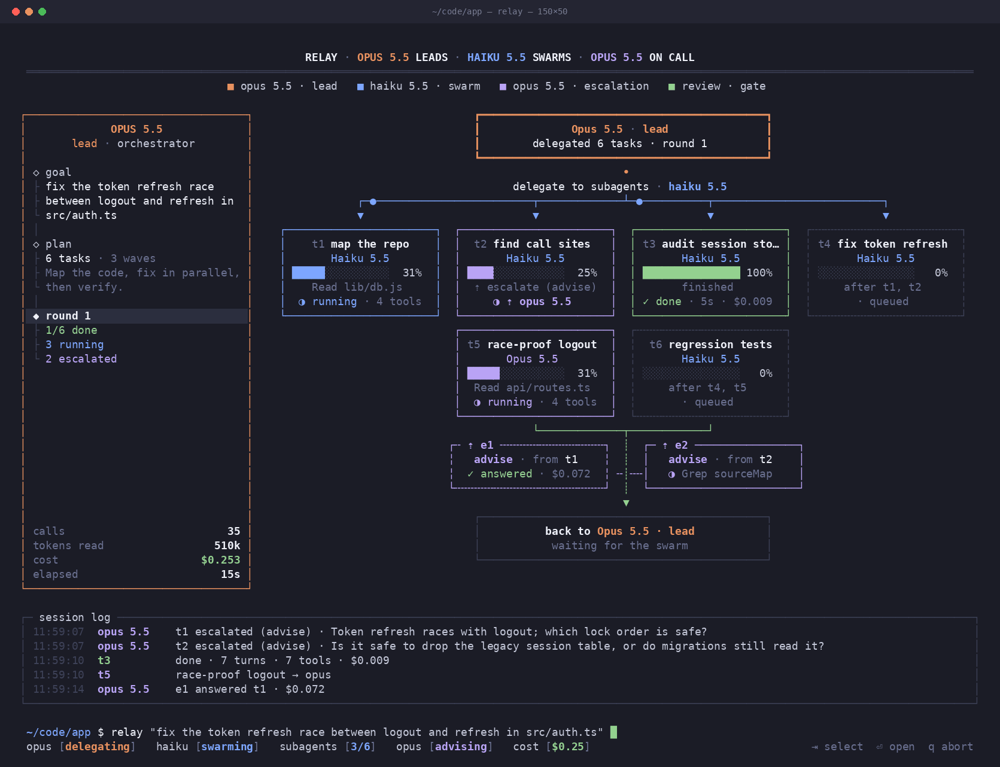
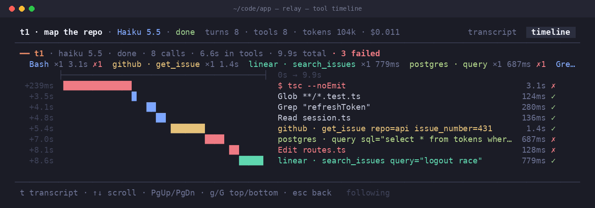

# relay

A multi-agent harness for the `claude` CLI, with a full-screen TUI.

**Website:** https://sm0ke21.github.io/relay/



<sub>Round 1 of a run (shown with simulated agents, <code>relay --mock</code>): t3 is done, t1 and the Opus-routed t5 are running, t2 is waiting on an Opus escalation, and t4/t6 are queued behind their dependencies.</sub>

- **Opus leads.** It reads the repo, splits the goal into tasks with dependencies, then reviews and verifies the results. It can run follow-up rounds.
- **Haiku swarms.** Workers run the tasks in parallel, each as its own `claude -p` process.
- **Opus on call.** Every worker has an `escalate_to_opus` tool. A worker that gets stuck hands the problem up: `advise` gets read-only guidance back, `delegate` has Opus do the work. Each escalation shows up live in the diagram.
- **A report for every run.** Each run leaves `.relay/runs/<time>/report.md`, `run.json` and the raw stream-json of every agent.

## Getting started

**Requirements**
- Node.js 20 or newer. There are no npm dependencies and no build step.
- The [Claude Code](https://claude.com/claude-code) CLI (`claude`) installed and logged in. relay starts every agent through it, so runs use your Claude account. If `claude` isn't on your `PATH`, set `RELAY_CLAUDE_BIN=/path/to/claude`.

**Install**

```
git clone https://github.com/sm0ke21/relay.git
cd relay
npm install -g .        # puts `relay` on your PATH (or `npm link` to follow the checkout)
```

You can also skip installing and run `node bin/relay.js` from the checkout.

**Try it for free first.** `--mock` swaps in simulated agents, so you can explore the TUI without spending tokens:

```
relay --mock
```

**Run it on a real project**

```
cd ~/code/myproject
relay "add input validation to the API"
```

Workers can edit files without asking, but **shell commands are blocked unless you allow them**. Without an `--allow` rule, nobody can run your tests:

```
relay --allow "Bash(npm test:*)" --allow "Bash(git diff:*)" "fix the failing auth tests"
```

Each run writes its report to `.relay/runs/` inside the project. You may want to add `.relay/` to that project's `.gitignore`.

### Usage

```
relay                                  # interactive: type tasks in the TUI
relay "add input validation to api/"   # start right away
relay --mock                           # simulated agents, no tokens spent
relay --plain "task"                   # log lines only (CI / pipes), no session
relay --budget 2 "task"                # stop dispatching new work past $2
```

### Shell completion

`relay attach <TAB>` completes live session ids and shows each one's phase, goal and directory. `logs`, `kill`, subcommands, flags and model names complete too.

```
# zsh (oh-my-zsh: any dir on $fpath works, e.g. ~/.oh-my-zsh/custom/completions)
relay completion zsh > ~/.oh-my-zsh/custom/completions/_relay && exec zsh
# bash
echo 'eval "$(relay completion bash)"' >> ~/.bashrc
```

## Detach and come back

Each run happens in a background **session** process, and the TUI is just a client attached to it, the same model as tmux.

```
relay "big refactor"        # attach as usual; press d (or ctrl-d) to detach
relay -d "big refactor"     # or start detached straight away
relay ls                    # live sessions + recently finished runs (with report paths)
relay attach [id]           # default: the newest session started in this directory
relay logs [id] [-f]        # print the session log; -f follows until the run ends
relay kill <id> | --all     # end sessions (aborts running agents)
```

You can close the terminal or log out and the agents keep working. Several clients can be attached to one session at once. When a run finishes, the session stays up, idle, so you can attach later, read transcripts and give it another task. After `--idle-timeout` hours (default 24) with nobody attached, it exits. Once a session is gone, `relay ls` still lists its run and report.

In the TUI, `ctrl-c` aborts the run; pressing it again ends the session. Session state is stored in `${XDG_STATE_HOME:-~/.local/state}/relay/` (override with `RELAY_STATE_DIR`), and each session's server log is there too.

## How it works

```
             ┌──────── Opus · lead ────────┐   plan  (--json-schema, read-only tools)
             └──────────────┬──────────────┘
          ┌─────────────────┼─────────────────┐
     Haiku worker      Haiku worker      Haiku worker     claude -p, in parallel, DAG order
          │ escalate_to_opus (MCP tool)
          └──► unix socket ──► relay ──► Opus  (advise: read-only / delegate: full)
          └─────────────────┬─────────────────┘
             ┌──── back to Opus · lead ────┐   review + verify → done | follow-up round
             └─────────────────────────────┘
```

- `src/session.js` holds the detachable session server, which owns the orchestrator and streams throttled snapshots plus transcript deltas over a unix socket. It also has the `RemoteSession` client that mirrors that state for the TUI.
- `src/orchestrator.js` runs plan → execute → review. It also runs the unix-socket server that takes escalations and launches them as agents.
- `src/escalate-mcp.js` is a stdio MCP server with no dependencies. Each worker gets it through `--mcp-config` and it forwards `escalate_to_opus` calls over the socket.
- `src/agent.js` spawns `claude -p --output-format stream-json` and parses the events into state.
- `src/tui.js` and `src/canvas.js` hold the renderer: a truecolor cell buffer that redraws only the rows that changed.

## Options

| flag | default | |
|---|---|---|
| `--lead / --worker / --escalate <model>` | opus / haiku / opus | any `--model` value |
| `--effort <level>` | high | lead + escalations |
| `-j, --concurrency <n>` | 4 | parallel workers |
| `--rounds <n>` | 3 | max plan/review rounds |
| `--max-tasks <n>` | 8 | per round |
| `--max-escalations <n>` | 6 | per run |
| `--budget <usd>` | none | stops dispatching once spend passes this; each agent also gets `--max-budget-usd` |
| `--permission-mode <m>` | acceptEdits | for workers |
| `--allow <rule>` | | repeatable, e.g. `--allow "Bash(npm test:*)"`. Also gives the reviewer Bash |
| `--yolo` | off | bypassPermissions for workers (sandboxes only) |
| `--inherit-mcp` | off | agents load your MCP servers (by default they are isolated, which is faster) |
| `--mcp-config <file>` | | repeatable; gives workers the MCP servers in this JSON file (`{"mcpServers": {...}}`), with their tools allowed |
| `-C, --cwd`, `--out`, `--keep-sessions`, `--plain`, `--mock` | | |

Workers can edit files without asking (`acceptEdits`), but shell commands are denied unless you allow them with `--allow`. Without that, nobody can run tests. Typical usage:

```
relay --allow "Bash(npm test:*)" --allow "Bash(git diff:*)" "fix the flaky auth tests"
```

## Tool calls and MCP

Every tool call an agent makes is tracked from start to result:



- **Worker boxes** show the current call. MCP calls are labelled `server · tool key-args` (e.g. `github · create_issue title="Fix race" repo=api`), and each server name gets its own colour.
- **Tool timeline:** open an agent (`enter`) and press `t`. Each call is a bar on the agent's own clock, with its duration and ✓/✗. Calls still running are shaded, and a summary line shows totals per tool, slowest first.
- **Reports** list each agent's tool calls with counts, total time and failures.

To try it with a real MCP server, use the bundled demo server. All its data is made up, and its tools take different amounts of time; one always fails:

```
node examples/demo-mcp.js --config > /tmp/demo-mcp.json
relay --mcp-config /tmp/demo-mcp.json \
  "Use the demo MCP tools: get the forecast for Athens, search the docs for 'token refresh', run slow_job for 3 seconds and call always_fails once. Then summarise the results in mcp-test.md."
```

`relay --mock` also includes fake `github`, `linear` and `postgres` calls, so you can see the labels and timeline for free.

## Keys

`tab`/arrows select the lead, a worker or an escalation · `enter` starts the typed task or opens the selected agent's transcript (↑↓ PgUp/PgDn g/G, esc to go back) · `t` in that view switches to the tool timeline · `d`/`ctrl-d` detaches · `q` aborts the run · `ctrl-c` aborts, then ends the session.

At least 100×30 is recommended. Below that the layout shrinks step by step and pages through worker rows.
